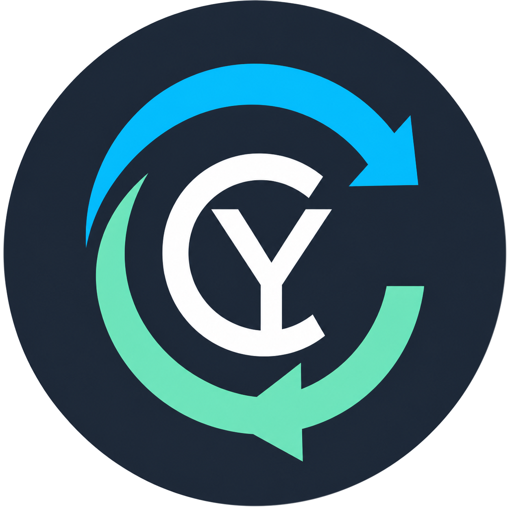
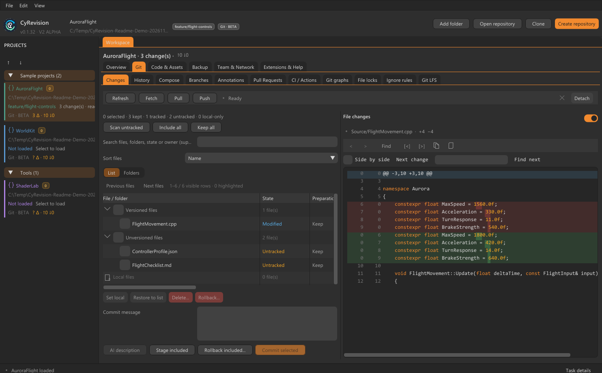
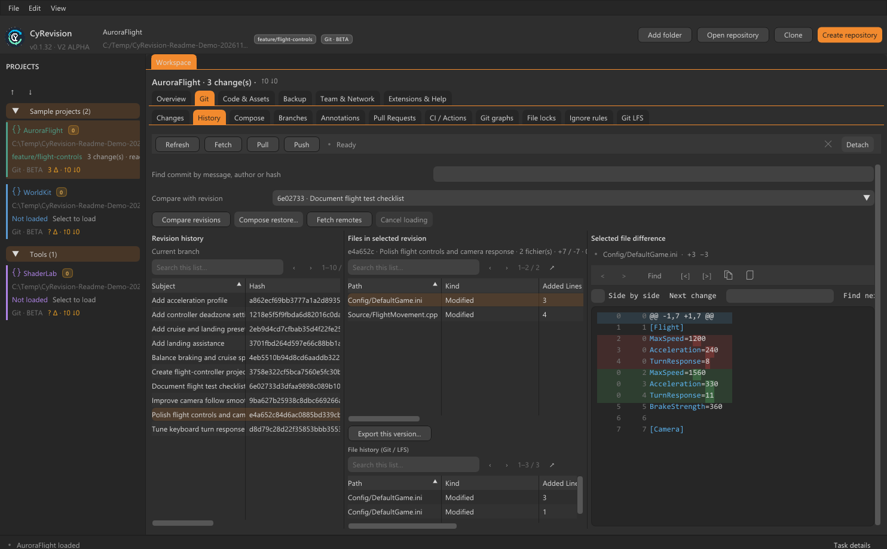
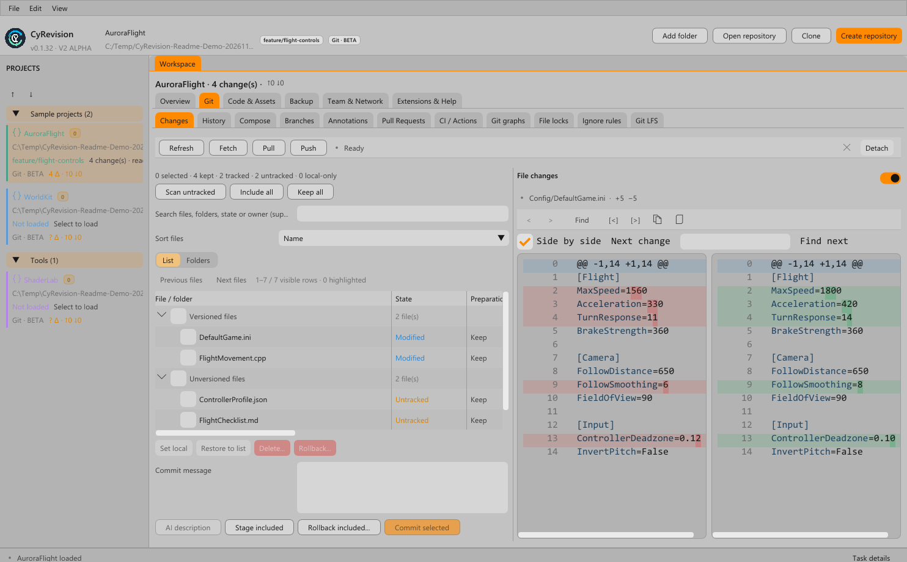

<table width="100%">
  <tr>
    <td width="300" align="left" valign="top">
      <a href="#à-propos-de-cyrevision">À propos de CyRevision</a> 
      <a href="Documentation/Documentation.html#/fr/getting-started">Manuel hors ligne · Français</a> 
      <a href="https://github.com/MrMybal/CyRevision">Dépôt des sources</a> 
      <a href="https://github.com/MrMybal/CyRevision/issues">Suivi des problèmes</a>  
      README 
      <a href="README.md">English</a> · <a href="README.fr.md">Français</a>
    </td>
    <td width="400" align="center" valign="middle">
      
    </td>
    <td width="300" align="right" valign="top">
      
Licence de l’application <a href="LICENSE"><strong>AGPL-3.0</strong></a>

      
Version <a href="docs/release-0.1.34.fr.md"><strong>0.1.34</strong></a> <strong>ALPHA</strong>

      
<a href="https://github.com/MrMybal/CyRevision/releases/tag/v0.1.34"><strong>Télécharger CyRevision</strong></a> Windows x64 · Linux x64 / ARM64 macOS Intel / Apple Silicon

    </td>
  </tr>
</table>

<h1 align="center">CyRevision</h1>

Client de révision, de synchronisation et de sauvegarde pour les projets lourds, notamment les productions Unreal Engine. Utilisez Git et Git LFS en local, examinez les changements et les pull requests, puis activez les services indépendants de sauvegarde ou d’échange entre pairs lorsque le projet en a besoin. GitHub est facultatif.

> **ALPHA · 0.1.34**
>
> Version publiée pour les essais et les retours ; certaines fonctions, interfaces et formats de stockage peuvent encore évoluer. Les fonctions Git sont en **Bêta** ; Native V2, Sync, Git + Sync, Lore, Backup et les plugins restent en **Alpha**. Conservez des sauvegardes indépendantes et testez la restauration avant un usage en production. Consultez les [notes de version et limites documentées](docs/release-0.1.34.fr.md).

Ces captures présentent l’interface Windows V2 enregistrée en version 0.1.32 avec le projet d’exemple AuroraFlight. La version publiée actuelle est la 0.1.34 ; Classic Avalonia reste disponible sur Windows, Linux et macOS.

## À propos de CyRevision

La barre latérale contient les projets ; chaque projet possède ses propres espaces de travail et réglages. Choisissez **Git**, **Git + Sync**, **Sync**, **Sync + versions** ou **Backup** sans démarrer automatiquement tous les services optionnels. Les plugins peuvent ajouter des modes propres au projet.

Préparez les changements, consultez l’historique des fichiers et de Git LFS, comparez des révisions et examinez les pull requests GitHub et leurs résultats CI. Détachez des vues pour travailler sur plusieurs écrans. Multi Restore et le compositeur de cherry-picks permettent de préparer restaurations et changements de branche avec aperçu et confirmation explicite.

En mode **Git + Sync**, les pairs échangent des bundles Git signés et des objets LFS adressés par leur contenu ; le dossier de travail et le `.git` actif restent locaux. **Sync sans Git** synchronise le dossier de projet sélectionné. Les snapshots SHA-256 et archives froides constituent un parcours de sauvegarde distinct.

Syncthing dispose d’un profil dédié à chaque projet CyRevision. CyRevision ne configure ni n’arrête une instance Syncthing personnelle existante ; il arrête seulement le processus enfant qu’il a lancé. Le VPN, les compilations distantes et les intégrations aux éditeurs sont optionnels et se configurent séparément.

Comparaison de configuration côte à côte

Les différences textuelles proposent des vues unifiées ou côte à côte. Les comparaisons d’images, cartes de chaleur, géométries OBJ et inspections simplifiées de packages Unreal répondent à d’autres types d’assets ; un aperçu de package hors ligne n’est pas un rendu de l’Unreal Editor.

## Fonctionnalités

- **Git et Git LFS** : statut, index, commits, branches, fusions, remotes, annotations, historique, comparaisons A ↔ B, verrous, graphes Git et historique par fichier/LFS.
- **Restauration et composition de branches** : choix des versions de fichiers avec Multi Restore, préparation de cherry-picks ordonnés, détection des patchs équivalents et mise à jour de branches locales inactives via des worktrees temporaires. Les restaurations protègent les changements locaux et créent des copies de récupération.
- **Pull requests et CI** : demandes GitHub/GitHub Enterprise, création, revues, conversations, fichiers/différences, indicateurs de propriétaire et d’état, inspection des conflits, fusion confirmée et nettoyage de branche locale. Consultez les logs CI complets, cherchez ou filtrez erreurs et avertissements, relancez les workflows ou annulez les exécutions autorisées.
- **Collaboration entre pairs** : échanges Git signés, inventaires LFS, transferts reprenables, admission par rôles, codes de vérification et révocation. L’échange Git ne synchronise pas le dossier `.git` actif.
- **Sauvegardes et stockage optionnel** : snapshots dédupliqués, rétention et copies d’archives froides ; déplacement et classement prudents du stockage LFS. Le mode optionnel **Git + CyStore — Alpha** capture les données LFS hydratées en blocs vérifiés et dédupliqués de 1 à 8 Mio, sans réécrire les pointeurs Git.
- **Code et assets** : arborescence du projet, recherche Ctrl+Maj+F, motifs de fichiers, liste des symboles, aperçu texte, historique des lignes sélectionnées et comparaisons d’assets indépendantes du moteur.
- **IA et MCP** : intégrations optionnelles Codex CLI, **OpenCode CLI**, API et modèles locaux, avec permissions explicites de lecture, modification, réseau, indexation et commit. Les profils MCP par projet proposent politiques d’outils, approbations, délais et blocage d’urgence.
- **Éditeurs et tâches** : compagnons Unreal, Unity et Godot optionnels, parcours Perforce `p4` propres au projet, liens et transitions Jira Cloud, ClickUp et CyTask. La clôture d’une tâche après fusion peut demander confirmation ou suivre une politique explicitement configurée.
- **Réseau et agents** : tunnels WireGuard optionnels, outils Unreal Swarm, réception de fichiers et partage de dossiers par VPN, recettes de compilation distante autorisées et agent Discord intégré ou autonome. Un serveur Linux distinct et optionnel fournit API, planification et tableau de bord web protégé.
- **Espace de travail et aide** : vues détachables, tableaux redimensionnables/réordonnables lorsque proposés, thèmes, préférences clavier, maintien dans la zone de notification et démarrage à la connexion. L’anglais est la langue par défaut ; le français est inclus.
- **Documentation locale** : 86 pages par langue, aide contextuelle F1, recherche Ctrl+K, arborescence, six thèmes de lecture, captures, galerie et schémas traduits.
- **Mises à jour** : recherche des releases publiées au démarrage ou dans Aide, lecture des notes et choix de téléchargement/installation. La mise à jour valide SHA-256 et arrête les services avant installation ; les brouillons et préversions sont ignorés.

---

## Installation

[Téléchargez la release 0.1.34 Alpha](https://github.com/MrMybal/CyRevision/releases/tag/v0.1.34). Les paquets de bureau sont autonomes : ni le SDK ni le runtime .NET ne sont nécessaires pour les utiliser.

| Plateforme | Paquets publiés | Démarrage |
| --- | --- | --- |
| Windows 10/11 x64 · Direct3D 11 pour V2 | [Installateur](https://github.com/MrMybal/CyRevision/releases/download/v0.1.34/CyRevision-Setup-0.1.34-win-x64.exe) · [ZIP portable](https://github.com/MrMybal/CyRevision/releases/download/v0.1.34/CyRevision-0.1.34-win-x64-portable.zip) | `CyRevision.Native.exe` ; `CyRevision.Desktop.exe` ou le raccourci Classic pour Avalonia. |
| Debian/Ubuntu Linux x64 | [DEB](https://github.com/MrMybal/CyRevision/releases/download/v0.1.34/CyRevision-0.1.34-linux-x64.deb) · [Archive portable](https://github.com/MrMybal/CyRevision/releases/download/v0.1.34/CyRevision-0.1.34-linux-x64-portable.tar.gz) | `cyrevision` après installation du paquet ; `CyRevision.Desktop` depuis l’archive. |
| Debian/Ubuntu Linux ARM64 | [DEB](https://github.com/MrMybal/CyRevision/releases/download/v0.1.34/CyRevision-0.1.34-linux-arm64.deb) · [Archive portable](https://github.com/MrMybal/CyRevision/releases/download/v0.1.34/CyRevision-0.1.34-linux-arm64-portable.tar.gz) | Classic Avalonia. |
| macOS 11+ · Intel | [DMG](https://github.com/MrMybal/CyRevision/releases/download/v0.1.34/CyRevision-0.1.34-osx-x64.dmg) · [ZIP de l’app](https://github.com/MrMybal/CyRevision/releases/download/v0.1.34/CyRevision-0.1.34-osx-x64-portable.zip) | Copier `CyRevision.app` dans Applications. |
| macOS 11+ · Apple Silicon | [DMG](https://github.com/MrMybal/CyRevision/releases/download/v0.1.34/CyRevision-0.1.34-osx-arm64.dmg) · [ZIP de l’app](https://github.com/MrMybal/CyRevision/releases/download/v0.1.34/CyRevision-0.1.34-osx-arm64-portable.zip) | Classic Avalonia. |

1. Choisissez le paquet adapté à votre plateforme. Gardez le dossier portable **complet**, notamment `Documentation`, plugins, agents et dossiers de runtime.
2. Installez/extrayez l’application et ouvrez un dépôt, clonez-en un, créez-en un ou ajoutez un dossier.
3. Choisissez le mode du projet et activez seulement les services nécessaires.

Git et Git LFS sont nécessaires aux parcours Git. Syncthing sert uniquement aux modes Sync ; les releases incluent ses runtimes officiels. WireGuard et les outils des fournisseurs/éditeurs ne sont requis que pour leurs intégrations. Consultez les [sommes SHA-256 publiées](https://github.com/MrMybal/CyRevision/releases/download/v0.1.34/SHA256SUMS.txt) et les [limites des paquets et de leur signature](docs/release-0.1.34.fr.md#limites-documentées). Pour les prochaines versions, utilisez **Aide > Rechercher des mises à jour**.

### Documentation

Ouvrez **Aide > Guide utilisateur**, ou appuyez sur **F1** pour l’espace actif. Les deux interfaces ouvrent le même [lecteur HTML français](Documentation/Documentation.html#/fr/getting-started) ; [l’anglais est également disponible](Documentation/Documentation.html#/en/getting-started). Conservez tout le dossier `Documentation`, y compris `DocData`. La lecture ne nécessite ni serveur web, ni CDN, ni runtime Node.js, ni connexion.

Ces liens visent le **lecteur local** : GitHub affiche les fichiers HTML comme sources et n’héberge pas ce manuel sous forme de site actif. Téléchargez/extrayez l’application ou le dossier documentaire complet avant d’ouvrir `Documentation/Documentation.html`. Le lecteur contient les parcours et références d’API publique ; `DocAI.md` est un fichier distinct pour les agents, pas un chapitre du manuel humain.

### Vitrine

La [vitrine bilingue de l’application](website/README.md) présente les parcours avec captures réelles, schémas traduits et agrandissement dans la page. Générez-la avec `node website/build.mjs`, puis ouvrez `dist/website/index.html`. Le lecteur CyDoc complet est copié dans son dossier `manual`. Il s’agit d’un compagnon statique local, pas d’un site hébergé publiquement.

## Sources, compilation et bibliothèques nécessaires

Compiler Classic, Windows V2 et les paquets de distribution

### Prérequis

- SDK .NET **9.x**, comme dans la CI ; l’application gérée cible **.NET 8**.
- Node.js **22+** et npm pour générer/vérifier le manuel pendant les builds, pas pour le lire.
- Git ; Git LFS pour tester les parcours LFS.
- Windows V2 : outils de bureau C++ Visual Studio, CMake **3.20+**, C++20 et Direct3D 11.
- Python 3 pour les scripts de paquetage/vérification ; Pillow uniquement pour régénérer les schémas en images. Inno Setup 6 pour un installateur Windows.
- Les services optionnels nécessitent leurs propres outils ; aucun n’est requis simplement pour lire ou compiler le manuel.

### Récupérer les sources

~~~sh
git clone https://github.com/MrMybal/CyRevision.git
cd CyRevision
~~~

### Compiler et lancer Classic

~~~sh
dotnet restore CyRevision.sln
dotnet build CyRevision.sln -c Release
dotnet test CyRevision.sln -c Release
dotnet run --project src/CyRevision.Desktop/CyRevision.Desktop.csproj -c Release
~~~

Ouvrez `CyRevision.sln` dans Rider ou un autre IDE .NET. Les outils d’IDE Avalonia sont facultatifs. `AvaloniaUI.DiagnosticsSupport` sert au développement et est exclu des ressources Release ; l’utilisation des Developer Tools distincts suit les [conditions de l’éditeur](https://docs.avaloniaui.net/tools/faq).

### Compiler Windows V2

~~~powershell
./scripts/build-native-v2.ps1
~~~

Lancez `artifacts/native-v2/CyRevision.Native.exe`. L’instantané CyUI épinglé et Dear ImGui sont inclus dans `native/vendor` ; le script télécharge un en-tête nlohmann/json dont la somme est vérifiée. Seuls les modules natifs choisis sont liés ; audio, CEF et démonstration sont désactivés.

### Construire les paquets et le manuel

~~~powershell
./scripts/build-release.cmd 0.1.34
~~~

~~~sh
bash scripts/build-linux-release.sh 0.1.34 linux-x64
bash scripts/build-linux-release.sh 0.1.34 linux-arm64
bash scripts/build-macos-release.sh 0.1.34 osx-x64
bash scripts/build-macos-release.sh 0.1.34 osx-arm64
~~~

Lancez le paquetage sur le système correspondant. Les [instructions de release](docs/releasing.md) décrivent les installateurs et la CI. `scripts/publish.ps1` et `scripts/publish.sh` fournissent les commandes de publication pour le développement.

Le build de bureau génère/copie tout le manuel. Ses sources et outils sont dans `.CyDocBuild` et ne sont pas distribués avec lui. Pour le régénérer ou le vérifier explicitement :

~~~sh
node .CyDocBuild/build.mjs
node .CyDocBuild/build.mjs --check
node --test .CyDocBuild/test/*.test.mjs
~~~

---

## Licence

**CyRevision utilise la [GNU Affero General Public License v3.0](LICENSE).** Les licences de CyUI, CyDoc et des autres dépendances ne remplacent pas celle de l’application.

### Principales bibliothèques

| Bibliothèque · sources | Licence · texte | Utilisation / périmètre |
| --- | --- | --- |
| [.NET / ASP.NET Core](https://github.com/dotnet/runtime) | [MIT et notices tierces](https://github.com/dotnet/runtime/blob/main/LICENSE.TXT) | Moteur de bureau géré, agents et serveur optionnel ; runtimes inclus dans les paquets publiés. |
| [Avalonia 12.1.0](https://github.com/AvaloniaUI/Avalonia) | [MIT](https://github.com/AvaloniaUI/Avalonia/blob/master/licence.md) | Interface Classic et hôte de bureau ; contrôles, thème Fluent et paquet de polices référencés par le projet de bureau. |
| [Inter](https://github.com/rsms/inter) | [SIL OFL-1.1](https://github.com/rsms/inter/blob/master/LICENSE.txt) | Police fournie via Avalonia.Fonts.Inter ; licence distincte de celle du framework. |
| [SkiaSharp](https://github.com/mono/SkiaSharp) | [MIT](https://github.com/mono/SkiaSharp/blob/main/LICENSE.txt), avec notices Skia/composants natifs | Comparaison d’images/assets et rendu Classic. Conserver les notices des composants natifs. |
| [CyUI 1.2](https://github.com/MrMybal/CyUI) | [MIT](native/vendor/CyUI/LICENSE) | Interface Windows V2 modulaire ; l’accès aux sources nécessite actuellement une autorisation. |
| [Dear ImGui](https://github.com/ocornut/imgui) | [MIT](native/vendor/CyUI/third_party/imgui/LICENSE.txt) ; [choix MIT / domaine public pour stb](native/vendor/CyUI/THIRD_PARTY_NOTICES.md) | Interface native et composants stb inclus. |
| [ImGuiColorTextEdit](https://github.com/goossens/ImGuiColorTextEdit) | [MIT](native/vendor/CyUI/third_party/texteditor/LICENSE) | Éditeur optionnel choisi par le module CodeEditor de V2. |
| [Lexilla / Scintilla / SciTE](https://github.com/ScintillaOrg/lexilla) | [Conditions permissives de type HPND](native/vendor/CyUI/third_party/lexilla/License.txt) | Moteurs syntaxiques, en-têtes publics et mots-clés ; aucune interface Scintilla n’est liée. |
| [nlohmann/json](https://github.com/nlohmann/json) | [MIT](native/Licenses/nlohmann-json.txt) | Messages JSON entre interface native et moteur géré. |
| [CyDoc 0.1.0](https://github.com/MrMybal/CyDoc) | [MIT](Documentation/DocData/CyDoc-LICENSE.txt) | Lecteur local avec modules image/galerie ; instantané de la bibliothèque épinglé par l’application. |

### Outils de compilation et de développement

| Bibliothèque · sources | Licence · texte | Utilisation / périmètre |
| --- | --- | --- |
| [marked](https://github.com/markedjs/marked) | [MIT](https://github.com/markedjs/marked/blob/v17.0.6/LICENSE.md) | Compilation du Markdown pendant la génération. |
| [PrismJS](https://github.com/PrismJS/prism) | [MIT](https://github.com/PrismJS/prism/blob/master/LICENSE) | Coloration du code pendant la génération. |
| [esbuild](https://github.com/evanw/esbuild) | [MIT](https://github.com/evanw/esbuild/blob/main/LICENSE.md) | Assemblage de la documentation. |
| [Happy DOM](https://github.com/capricorn86/happy-dom) | [MIT](https://github.com/capricorn86/happy-dom/blob/master/LICENSE) | Fixtures DOM de test documentaire uniquement. |
| [AvaloniaUI.DiagnosticsSupport](https://www.nuget.org/packages/AvaloniaUI.DiagnosticsSupport/2.2.3) | [FAQ intégration/outillage de l’éditeur](https://docs.avaloniaui.net/tools/faq) | Pont réservé au débogage ; le référencer ne nécessite pas de licence Developer Tools, contrairement à l’ouverture de ces outils. Ne reprend pas la classification MIT du framework principal. |
| [xUnit.net](https://github.com/xunit/xunit) | [Apache-2.0](https://licenses.nuget.org/Apache-2.0) | Tests gérés, pas le runtime de l’application. |
| [Node.js](https://github.com/nodejs/node) | [MIT et notices des composants](https://github.com/nodejs/node/blob/main/LICENSE) | Outils de build documentaire uniquement ; non inclus pour la lecture. |
| [CPython](https://github.com/python/cpython) / [Pillow](https://github.com/python-pillow/Pillow) | [PSF et notices des composants](https://github.com/python/cpython/blob/3.11/LICENSE) / [MIT-CMU](https://github.com/python-pillow/Pillow/blob/main/LICENSE) | Scripts de paquetage et rédaction optionnelle des schémas ; pas un prérequis du runtime de bureau. |
| [CMake](https://github.com/Kitware/CMake) | [BSD-3-Clause et notices](https://cmake.org/licensing/) | Configuration du build natif. MSVC et Inno Setup conservent leurs conditions d’outillage. |

### Outils et intégrations hôtes optionnels

| Bibliothèque · sources | Licence · texte | Utilisation / périmètre |
| --- | --- | --- |
| [Git](https://git-scm.com/) | [GPL-2.0](https://github.com/git/git/blob/master/COPYING) | CLI externe pour les projets Git. |
| [Git LFS](https://github.com/git-lfs/git-lfs) | [MIT](https://github.com/git-lfs/git-lfs/blob/main/LICENSE.md) | CLI externe pour les projets LFS. |
| [Syncthing](https://github.com/syncthing/syncthing) | [MPL-2.0](https://github.com/syncthing/syncthing/blob/main/LICENSE) | Runtime officiel inclus ; démarrage seulement lorsque le mode Sync choisi est activé. |
| [WireGuard](https://www.wireguard.com/) | [Conditions propres aux composants de la plateforme](src/CyRevision.Desktop/VpnRuntime/README.md) ; [wireguard-tools GPL-2.0](https://git.zx2c4.com/wireguard-tools/tree/COPYING) | Runtime VPN système ou fourni séparément, optionnel. |
| [Perforce p4](https://www.perforce.com/products/helix-core) | [Conditions Perforce](https://www.perforce.com/legal) | CLI externe optionnel ; pas une bibliothèque libre incluse. |
| [Unreal Engine](https://www.unrealengine.com/) | [Conditions Unreal Engine d’Epic](https://www.unrealengine.com/eula/unreal) | Éditeur/SDK hôte du compagnon optionnel ; le moteur n’est pas distribué avec CyRevision. |

Ce tableau indexe les composants principaux sans remplacer leurs notices transitives complètes. Conservez `Licenses`, `Documentation/DocData/CyDoc-LICENSE.txt`, les notices natives et les références de licence/sources Syncthing du paquet. L’accès aux dépôts privés n’est pas nécessaire pour lire les textes de licence inclus dans un paquet.

## Références et liens

- [Manuel local français](Documentation/Documentation.html#/fr/getting-started) · [English local manual](Documentation/Documentation.html#/en/getting-started).
- [Release 0.1.34](https://github.com/MrMybal/CyRevision/releases/tag/v0.1.34) · [Sommes SHA-256](https://github.com/MrMybal/CyRevision/releases/download/v0.1.34/SHA256SUMS.txt) · [Suivi des problèmes](https://github.com/MrMybal/CyRevision/issues).
- [Architecture](docs/architecture.md) · [Modèle de sécurité](docs/security.md) · [Serveur/API](docs/server-api.md) · [Configuration du serveur Linux](docs/linux-server.md).
- [Compagnon Unreal](plugins/CyRevisionUnreal/README.md) · [Compagnon Unity](plugins/CyRevisionUnity/README.md) · [Compagnon Godot](plugins/CyRevisionGodot/README.md).
- [Paquetage des releases](docs/releasing.md) · [Notes de version françaises](docs/release-0.1.34.fr.md) · [English version notes](docs/release-0.1.34.md).
