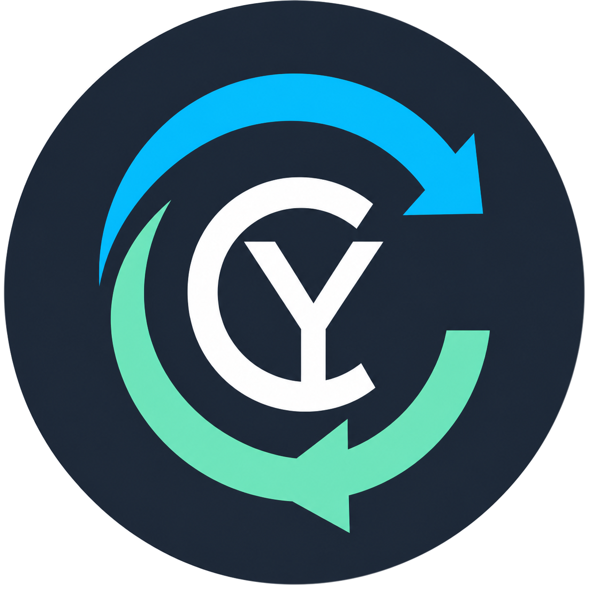
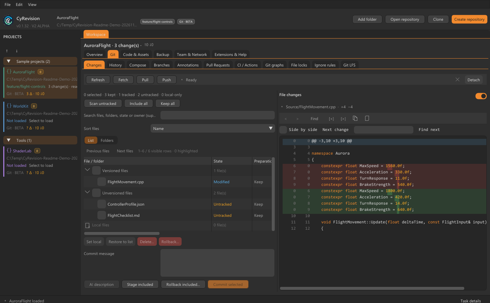
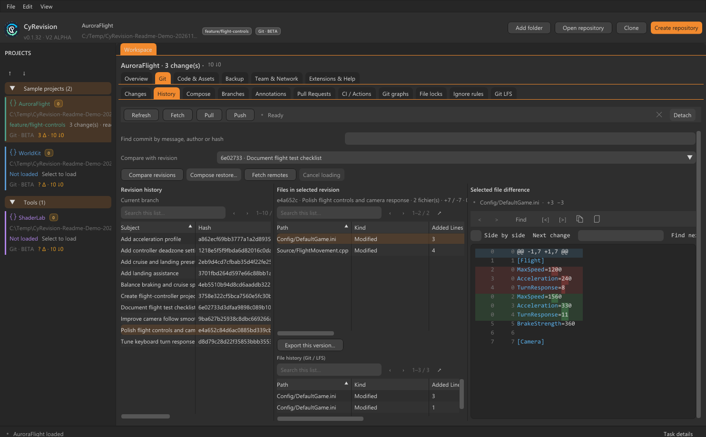
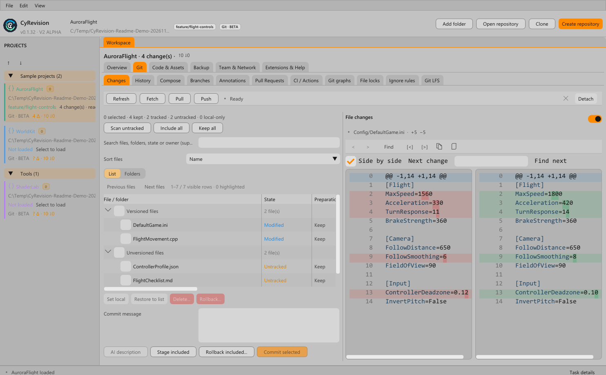

<table width="100%">
  <tr>
    <td width="300" align="left" valign="top">
      <a href="#about-cyrevision">About CyRevision</a> 
      <a href="Documentation/Documentation.html#/en/getting-started">Offline manual · English</a> 
      <a href="https://github.com/MrMybal/CyRevision">Source repository</a> 
      <a href="https://github.com/MrMybal/CyRevision/issues">Issue tracker</a>  
      README 
      <a href="README.md">English</a> · <a href="README.fr.md">Français</a>
    </td>
    <td width="400" align="center" valign="middle">
      
    </td>
    <td width="300" align="right" valign="top">
      
Application license <a href="LICENSE"><strong>AGPL-3.0</strong></a>

      
Version <a href="docs/release-0.1.34.md"><strong>0.1.34</strong></a> <strong>ALPHA</strong>

      
<a href="https://github.com/MrMybal/CyRevision/releases/tag/v0.1.34"><strong>Download CyRevision</strong></a> Windows x64 · Linux x64 / ARM64 macOS Intel / Apple Silicon

    </td>
  </tr>
</table>

<h1 align="center">CyRevision</h1>

A revision-control, synchronization and backup client for large projects, especially Unreal Engine productions. Work with local Git and Git LFS, review changes and pull requests, or enable independent backup and peer-to-peer services when a project needs them. GitHub is optional.

> **ALPHA · 0.1.34**
>
> Published for testing and feedback; features, interfaces and storage formats can still change. Git workflows are **Beta**; Native V2, Sync, Git + Sync, Lore, Backup and plugins remain **Alpha**. Keep independent backups and test recovery before production use. Read the [version notes and documented limitations](docs/release-0.1.34.md).

The screenshots show the Windows V2 interface captured in 0.1.32 with the AuroraFlight sample project. The current published version is 0.1.34; Classic Avalonia remains available on Windows, Linux and macOS.

## About CyRevision

The sidebar contains projects; each project has its own workspaces and settings. Choose **Git**, **Git + Sync**, **Sync**, **Sync + Versions** or **Backup** without automatically starting every optional service. Plugins can contribute additional project-scoped modes.

Prepare changes, inspect file and Git LFS history, compare revisions and review GitHub pull requests and CI results. Detach workspaces for multi-monitor review. Multi Restore and the cherry-pick composer let you prepare recovery or branch changes with previews and explicit confirmation.

In **Git + Sync**, peers exchange signed Git bundles and content-addressed LFS objects; the working tree and active `.git` directory stay local. **Sync without Git** synchronizes the selected project folder. SHA-256 snapshots and cold archives provide a separate backup workflow.

Syncthing uses a dedicated profile for each CyRevision project. CyRevision never configures or stops an existing personal Syncthing instance; it stops only the child process it started. VPN, remote builds and editor integrations are optional and configured separately.

Side-by-side configuration comparison

Text comparisons support unified and side-by-side views. Image comparisons, heatmaps, OBJ geometry and simplified Unreal-package inspection serve different asset types; an offline package preview is not an Unreal Editor rendering.

## Features

- **Git and Git LFS:** status, staging, commits, branches, merges, remotes, annotations, history, A ↔ B comparisons, file locks, Git graphs and per-file/LFS history.
- **Recovery and branch composition:** select file versions with Multi Restore; prepare ordered cherry-picks, identify equivalent patches and update inactive local branches through temporary worktrees. Local-change protection and recovery copies accompany restore operations.
- **Pull requests and CI:** GitHub/GitHub Enterprise requests, creation, reviews, conversations, files/diffs, ownership and state indicators, conflict inspection, confirmed merging and local branch cleanup. Read complete CI logs, search/filter errors and warnings, rerun workflows or cancel eligible runs.
- **P2P collaboration:** signed Git exchange, LFS inventories, resumable transfers, role-based peer admission, verification codes and revocation. Git exchange does not synchronize the active `.git` directory.
- **Backups and optional storage:** deduplicated snapshots, retention and cold-archive copies; safe LFS storage relocation/classification. The optional **Git + CyStore — Alpha** mode captures hydrated LFS data in verified, deduplicated 1–8 MiB chunks without rewriting Git pointers.
- **Code and assets:** project tree, Ctrl+Shift+F search, file patterns, symbol outline, text preview, selected-line history and engine-independent asset comparisons.
- **AI and MCP:** optional Codex CLI, **OpenCode CLI**, API and local-model integrations, with explicit read/edit/network/stage/commit permissions. Project-scoped MCP profiles include tool policies, approval modes, timeouts and an emergency block switch.
- **Editor and task integrations:** optional Unreal, Unity and Godot companions, project-scoped Perforce `p4` workflows, and Jira Cloud, ClickUp and CyTask links/transitions. Task completion after merge can require confirmation or follow an explicitly configured policy.
- **Network and agents:** optional WireGuard tunnels, Unreal Swarm tools, VPN file inbox/folder sharing, allowlisted remote-build recipes and an integrated or autonomous Discord agent. A separate optional Linux server provides an API, scheduling and a protected web dashboard.
- **Workspace and help:** detachable views, resizable/reorderable tables where offered, themes, keyboard preferences, tray residence and launch-at-login controls. English is the default; French is included.
- **Local documentation:** 86 pages in each language, contextual F1 links, Ctrl+K search, nested navigation, six reader themes, screenshots, a gallery and localized diagrams.
- **Application updates:** check published releases at startup or from Help, review release notes and choose download/install. The updater verifies SHA-256 and stops background services before installation; drafts and prereleases are ignored.

---

## Installation

[Download release 0.1.34 Alpha](https://github.com/MrMybal/CyRevision/releases/tag/v0.1.34). Desktop packages are self-contained: installing the .NET SDK or runtime is not required to run them.

| Platform | Published packages | Start |
| --- | --- | --- |
| Windows 10/11 x64 · Direct3D 11 for V2 | [Installer](https://github.com/MrMybal/CyRevision/releases/download/v0.1.34/CyRevision-Setup-0.1.34-win-x64.exe) · [Portable ZIP](https://github.com/MrMybal/CyRevision/releases/download/v0.1.34/CyRevision-0.1.34-win-x64-portable.zip) | `CyRevision.Native.exe`; `CyRevision.Desktop.exe` or the Classic shortcut for Avalonia. |
| Debian/Ubuntu Linux x64 | [DEB](https://github.com/MrMybal/CyRevision/releases/download/v0.1.34/CyRevision-0.1.34-linux-x64.deb) · [Portable archive](https://github.com/MrMybal/CyRevision/releases/download/v0.1.34/CyRevision-0.1.34-linux-x64-portable.tar.gz) | `cyrevision` after package installation; `CyRevision.Desktop` from the archive. |
| Debian/Ubuntu Linux ARM64 | [DEB](https://github.com/MrMybal/CyRevision/releases/download/v0.1.34/CyRevision-0.1.34-linux-arm64.deb) · [Portable archive](https://github.com/MrMybal/CyRevision/releases/download/v0.1.34/CyRevision-0.1.34-linux-arm64-portable.tar.gz) | Classic Avalonia. |
| macOS 11+ · Intel | [DMG](https://github.com/MrMybal/CyRevision/releases/download/v0.1.34/CyRevision-0.1.34-osx-x64.dmg) · [App ZIP](https://github.com/MrMybal/CyRevision/releases/download/v0.1.34/CyRevision-0.1.34-osx-x64-portable.zip) | Copy `CyRevision.app` to Applications. |
| macOS 11+ · Apple Silicon | [DMG](https://github.com/MrMybal/CyRevision/releases/download/v0.1.34/CyRevision-0.1.34-osx-arm64.dmg) · [App ZIP](https://github.com/MrMybal/CyRevision/releases/download/v0.1.34/CyRevision-0.1.34-osx-arm64-portable.zip) | Classic Avalonia. |

1. Choose the package for your platform. Keep the **entire** portable folder, including `Documentation`, plugins, agents and runtime directories.
2. Install/extract the application and open an existing repository, clone a repository, create one or add a folder.
3. Select a project mode and enable only the services it needs.

Git and Git LFS are required for Git workflows. Syncthing is used only by Sync modes; official runtimes are included in release packages. WireGuard and provider/editor tools are needed only when their integrations are enabled. See the [published SHA-256 sums](https://github.com/MrMybal/CyRevision/releases/download/v0.1.34/SHA256SUMS.txt) and [package/trust limitations](docs/release-0.1.34.md#documented-limitations). Use **Help > Check for updates** for later releases.

### Documentation

Open **Help > User guide** or press **F1** for the active workspace. Both interfaces open the same [English HTML reader](Documentation/Documentation.html#/en/getting-started); [French is also available](Documentation/Documentation.html#/fr/getting-started). Keep the whole `Documentation` folder, including `DocData`. No web server, CDN, Node.js runtime or connection is required to read it.

These are **local-reader links**: GitHub displays HTML files as source and does not host this manual as a live website. Download/extract the application or the complete documentation folder before opening `Documentation/Documentation.html`. The reader contains workflows and public API references; `DocAI.md` is a separate agent-oriented file, not a human manual chapter.

### Showcase

The [bilingual application showcase](website/README.md) presents the workflows with real screenshots, localized diagrams and in-page image enlargement. Build it with `node website/build.mjs`, then open `dist/website/index.html`. The complete CyDoc reader is copied into its `manual` directory. This is a local static companion, not a publicly hosted website.

## Source, build and required libraries

Build Classic, Windows V2 and distribution packages

### Requirements

- .NET SDK **9.x**, matching CI; the managed application targets **.NET 8**.
- Node.js **22+** and npm for documentation generation/checks during builds, not for reading the manual.
- Git; Git LFS when testing LFS workflows.
- Windows V2: Visual Studio C++ desktop tools, CMake **3.20+**, C++20 and Direct3D 11.
- Python 3 for packaging/check scripts; Pillow only when regenerating diagram images. Inno Setup 6 for a Windows installer.
- Optional services require their own tools; none is needed merely to read or build the manual.

### Get the source

~~~sh
git clone https://github.com/MrMybal/CyRevision.git
cd CyRevision
~~~

### Build and run Classic

~~~sh
dotnet restore CyRevision.sln
dotnet build CyRevision.sln -c Release
dotnet test CyRevision.sln -c Release
dotnet run --project src/CyRevision.Desktop/CyRevision.Desktop.csproj -c Release
~~~

Open `CyRevision.sln` in Rider or another .NET IDE. Avalonia's IDE tools are optional. `AvaloniaUI.DiagnosticsSupport` is development-only and excluded from Release assets; connecting the separate Developer Tools is governed by the [publisher's tooling requirements](https://docs.avaloniaui.net/tools/faq).

### Build Windows V2

~~~powershell
./scripts/build-native-v2.ps1
~~~

Start `artifacts/native-v2/CyRevision.Native.exe`. The pinned CyUI source and Dear ImGui are included under `native/vendor`; the script downloads a checksum-pinned nlohmann/json header. Only the selected native modules are linked; audio, CEF and the demo are disabled.

### Build packages and the manual

~~~powershell
./scripts/build-release.cmd 0.1.34
~~~

~~~sh
bash scripts/build-linux-release.sh 0.1.34 linux-x64
bash scripts/build-linux-release.sh 0.1.34 linux-arm64
bash scripts/build-macos-release.sh 0.1.34 osx-x64
bash scripts/build-macos-release.sh 0.1.34 osx-arm64
~~~

Run platform packaging on its matching operating system. [Release build instructions](docs/releasing.md) describe the installers and CI. `scripts/publish.ps1` and `scripts/publish.sh` provide development publish commands.

The desktop build generates/copies the complete manual. Its sources/toolchain are under `.CyDocBuild` and are not shipped with the manual. To regenerate or check it explicitly:

~~~sh
node .CyDocBuild/build.mjs
node .CyDocBuild/build.mjs --check
node --test .CyDocBuild/test/*.test.mjs
~~~

---

## License

**CyRevision uses the [GNU Affero General Public License v3.0](LICENSE).** The licenses of CyUI, CyDoc and other dependencies do not replace the application's license.

### Main libraries

| Library · source | License · terms | Use / scope |
| --- | --- | --- |
| [.NET / ASP.NET Core](https://github.com/dotnet/runtime) | [MIT and third-party notices](https://github.com/dotnet/runtime/blob/main/LICENSE.TXT) | Managed desktop engine, agents and optional server; runtimes are bundled in published packages. |
| [Avalonia 12.1.0](https://github.com/AvaloniaUI/Avalonia) | [MIT](https://github.com/AvaloniaUI/Avalonia/blob/master/licence.md) | Classic interface and desktop host; controls, Fluent theme and font package are referenced by the desktop project. |
| [Inter](https://github.com/rsms/inter) | [SIL OFL-1.1](https://github.com/rsms/inter/blob/master/LICENSE.txt) | Typeface supplied through Avalonia.Fonts.Inter; distinct from the framework license. |
| [SkiaSharp](https://github.com/mono/SkiaSharp) | [MIT](https://github.com/mono/SkiaSharp/blob/main/LICENSE.txt), with Skia/native component notices | Image/asset comparisons and Classic graphics. Preserve native component notices. |
| [CyUI 1.2](https://github.com/MrMybal/CyUI) | [MIT](native/vendor/CyUI/LICENSE) | Modular Windows V2 interface; source access currently requires permission. |
| [Dear ImGui](https://github.com/ocornut/imgui) | [MIT](native/vendor/CyUI/third_party/imgui/LICENSE.txt); [stb MIT / public-domain choice](native/vendor/CyUI/THIRD_PARTY_NOTICES.md) | Native UI and embedded stb components. |
| [ImGuiColorTextEdit](https://github.com/goossens/ImGuiColorTextEdit) | [MIT](native/vendor/CyUI/third_party/texteditor/LICENSE) | Optional editor component selected by V2's CodeEditor module. |
| [Lexilla / Scintilla / SciTE](https://github.com/ScintillaOrg/lexilla) | [HPND-style permissive terms](native/vendor/CyUI/third_party/lexilla/License.txt) | Syntax engines, public headers and keyword data; no Scintilla UI is linked. |
| [nlohmann/json](https://github.com/nlohmann/json) | [MIT](native/Licenses/nlohmann-json.txt) | Native frontend/managed-engine JSON messages. |
| [CyDoc 0.1.0](https://github.com/MrMybal/CyDoc) | [MIT](Documentation/DocData/CyDoc-LICENSE.txt) | Bundled local reader with image/gallery modules; the application pins its library snapshot. |

### Build and development tools

| Library · source | License · terms | Use / scope |
| --- | --- | --- |
| [marked](https://github.com/markedjs/marked) | [MIT](https://github.com/markedjs/marked/blob/v17.0.6/LICENSE.md) | Build-time Markdown compilation. |
| [PrismJS](https://github.com/PrismJS/prism) | [MIT](https://github.com/PrismJS/prism/blob/master/LICENSE) | Build-time code highlighting. |
| [esbuild](https://github.com/evanw/esbuild) | [MIT](https://github.com/evanw/esbuild/blob/main/LICENSE.md) | Documentation bundling. |
| [Happy DOM](https://github.com/capricorn86/happy-dom) | [MIT](https://github.com/capricorn86/happy-dom/blob/master/LICENSE) | Documentation DOM test fixtures only. |
| [AvaloniaUI.DiagnosticsSupport](https://www.nuget.org/packages/AvaloniaUI.DiagnosticsSupport/2.2.3) | [Publisher's integration/tooling FAQ](https://docs.avaloniaui.net/tools/faq) | Debug-only bridge; referencing it does not require a Developer Tools license, but opening Developer Tools does. Not classified as the core framework's MIT license. |
| [xUnit.net](https://github.com/xunit/xunit) | [Apache-2.0](https://licenses.nuget.org/Apache-2.0) | Managed tests, not the application runtime. |
| [Node.js](https://github.com/nodejs/node) | [MIT and component notices](https://github.com/nodejs/node/blob/main/LICENSE) | Documentation build tools only; not bundled for reading. |
| [CPython](https://github.com/python/cpython) / [Pillow](https://github.com/python-pillow/Pillow) | [PSF and component notices](https://github.com/python/cpython/blob/3.11/LICENSE) / [MIT-CMU](https://github.com/python-pillow/Pillow/blob/main/LICENSE) | Packaging scripts and optional diagram authoring; not a desktop runtime requirement. |
| [CMake](https://github.com/Kitware/CMake) | [BSD-3-Clause and notices](https://cmake.org/licensing/) | Native build configuration. MSVC and Inno Setup have their own toolchain terms. |

### Optional tools and host integrations

| Library · source | License · terms | Use / scope |
| --- | --- | --- |
| [Git](https://git-scm.com/) | [GPL-2.0](https://github.com/git/git/blob/master/COPYING) | External CLI for Git projects. |
| [Git LFS](https://github.com/git-lfs/git-lfs) | [MIT](https://github.com/git-lfs/git-lfs/blob/main/LICENSE.md) | External CLI for LFS projects. |
| [Syncthing](https://github.com/syncthing/syncthing) | [MPL-2.0](https://github.com/syncthing/syncthing/blob/main/LICENSE) | Official bundled runtime; starts only when the selected Sync mode is enabled. |
| [WireGuard](https://www.wireguard.com/) | [Platform-specific component terms](src/CyRevision.Desktop/VpnRuntime/README.md); [wireguard-tools GPL-2.0](https://git.zx2c4.com/wireguard-tools/tree/COPYING) | Optional system or separately provided VPN runtime. |
| [Perforce p4](https://www.perforce.com/products/helix-core) | [Perforce's terms](https://www.perforce.com/legal) | Optional external CLI; not an included open-source library. |
| [Unreal Engine](https://www.unrealengine.com/) | [Epic's Unreal Engine terms](https://www.unrealengine.com/eula/unreal) | Host editor/SDK for the optional companion; the engine is not distributed with CyRevision. |

This is an index of main components, not a replacement for complete transitive notices. Keep the package's `Licenses`, `Documentation/DocData/CyDoc-LICENSE.txt`, native notices and Syncthing license/source references. Private repository access is not required to read the license texts included in a package.

## References and links

- [English local manual](Documentation/Documentation.html#/en/getting-started) · [Manuel local en français](Documentation/Documentation.html#/fr/getting-started).
- [Release 0.1.34](https://github.com/MrMybal/CyRevision/releases/tag/v0.1.34) · [SHA-256 sums](https://github.com/MrMybal/CyRevision/releases/download/v0.1.34/SHA256SUMS.txt) · [Issue tracker](https://github.com/MrMybal/CyRevision/issues).
- [Architecture](docs/architecture.md) · [Security model](docs/security.md) · [Server/API](docs/server-api.md) · [Linux server setup](docs/linux-server.md).
- [Unreal companion](plugins/CyRevisionUnreal/README.md) · [Unity companion](plugins/CyRevisionUnity/README.md) · [Godot companion](plugins/CyRevisionGodot/README.md).
- [Release packaging](docs/releasing.md) · [English version notes](docs/release-0.1.34.md) · [Notes de version en français](docs/release-0.1.34.fr.md).
